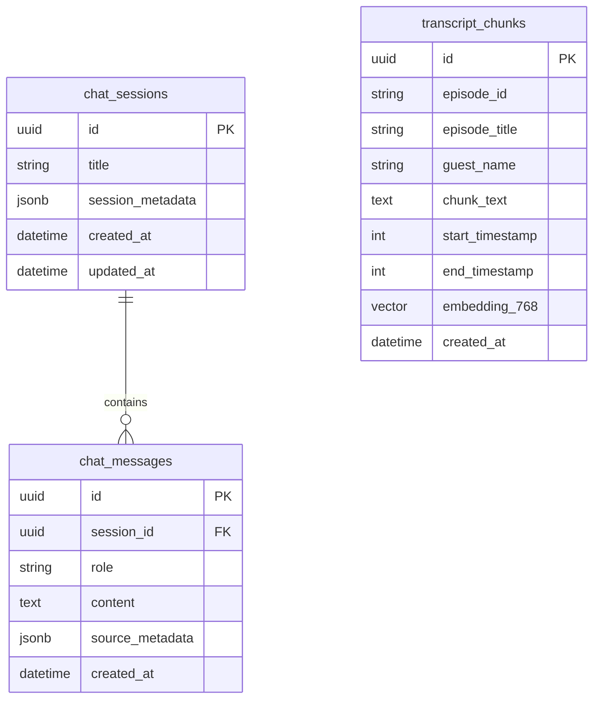
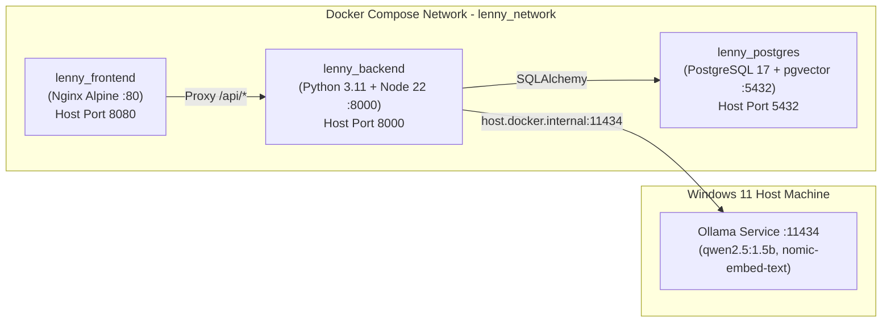

# System Architecture & Technical Specification
## The Lenny Growth Assistant

**Document Status**: Phase 9 — Final Project Completion, Documentation and Submission Readiness (Source & Configuration Complete; Consolidated Testing Pending)  
**Target Completion Date**: 12 October 2026, End of Day  
**Author**: Forward Deployed Engineering & AI Solutions Architecture Team  
**Evaluation Context**: Oogway Labs Forward Deployed Engineer Take-Home Assessment  

---

## 1. High-Level Architecture Overview

The **Lenny Growth Assistant** is an agentic, decoupled, multi-tier web application designed to run reliably on commodity hardware (Windows 11, 8 GB RAM) via local Ollama inference while offering seamless zero-code runtime switching to cloud LLMs (Google Gemini `gemini-2.5-flash` via Google AI Studio free tier).

```mermaid
graph TB
    subgraph Client Tier [Client Tier - Browser]
        ReactUI["React 18 + Vite SPA<br/>(Port 5173 / 8080)<br/>Vanilla CSS Tokens | Dark Slate<br/>Three-Panel Workspace Shell"]
        ModelSelector["Model Selector Modal<br/>(Local Ollama / Cloud Google Gemini)"]
        ArtifactViewer["Sandboxed Artifact Viewer<br/>(iframe sandbox='' | CSP 'none')"]
    end

    subgraph Gateway Tier [FastAPI Application Tier - Port 8000]
        API["FastAPI 0.110+ API Gateway<br/>(Pydantic v2 Validation | CORS | Error Handling)"]
        SessionMgr["Session & History Manager<br/>(PostgreSQL Persistence)"]
        RAGModule["RAG Retrieval Engine<br/>(Semantic Search | Cosine Distance)"]
        Sanitizer["Python HTMLParser Sanitizer<br/>(Tag & Style Whitelist)"]
        PiBridge["Pi Coding Agent RPC Subprocess Bridge<br/>(JSONL Event Processor | Timeout Guards)"]
    end

    subgraph Skills [Specialized Skill Orchestrators]
        Ship30["Ship 30 for 30 Essay Orchestrator<br/>(~1,250 words | Hooks | Pillars)"]
        HtmlSkill["HTML/CSS Design Skill<br/>(Landing Pages | Dashboards | Tables)"]
    end

    subgraph Data Tier [Persistence Tier - Port 5432]
        PG[(PostgreSQL 17 + pgvector<br/>chat_sessions | chat_messages<br/>transcript_chunks | HNSW Index)]
    end

    subgraph AI Tier [AI Inference Runtime Tier]
        Ollama["Local Ollama Service<br/>(Port 11434)<br/>qwen2.5:1.5b | nomic-embed-text"]
        CloudAPI["Cloud Google Gemini API<br/>gemini-2.5-flash<br/>(GEMINI_API_KEY via Subprocess Env)"]
        PiNode["Pi Coding Agent Node Runtime<br/>(@earendil-works/pi-coding-agent)"]
    end

    ReactUI -->|REST / JSON| API
    ModelSelector -->|GET /api/models| API
    API --> SessionMgr
    API --> RAGModule
    API --> Sanitizer
    API --> PiBridge
    SessionMgr -->|SQLAlchemy 2.x / psycopg3| PG
    RAGModule -->|Vector Query <=> 768d| PG
    RAGModule -->|Embeddings Query| Ollama
    PiBridge --> PiNode
    PiNode -->|HTTP Inference| Ollama
    PiNode -.->|Cloud Inference| CloudAPI
    PiBridge --> Ship30
    PiBridge --> HtmlSkill
    Sanitizer --> ArtifactViewer
```

---

## 2. Component Boundaries & Responsibilities

### 2.1 Frontend Client (`/frontend`) [Implemented]
- **Technology**: React 18, Vite, Vanilla CSS design system, Lucide icons.
- **Responsibilities**:
  - Three-panel responsive layout: Session History Sidebar (260px), Chat Workspace (flexible), and Sandboxed Artifact Viewer (resizable with drag-handle).
  - Runtime model selector modal supporting switching between Local Ollama and Cloud Google Gemini.
  - Interactive citations drawer displaying verified podcast sources with timestamps and verbatim quotes.
  - Safe Markdown rendering and isolated iframe HTML/CSS preview (`sandbox=""`).

### 2.2 Backend API Gateway (`/backend/app`) [Implemented]
- **Technology**: Python 3.11/3.12, FastAPI, Pydantic v2, SQLAlchemy 2.x, Alembic, custom Python `HTMLParser`.
- **Responsibilities**:
  - Request/response validation and structured error handling.
  - Session and message lifecycle management.
  - Grounded RAG retrieval coordination with cosine distance filtering.
  - Subprocess lifecycle management for the Pi Coding Agent RPC bridge.
  - Strict server-side HTML/CSS sanitization before persistence and preview.

### 2.3 Agent Orchestration (`backend/app/agent/`) [Implemented]
- **Technology**: Genuine **Pi Coding Agent** (`@earendil-works/pi-coding-agent`), Node.js 22 LTS subprocess bridge.
- **Responsibilities**:
  - Communicates with Pi CLI via JSONL stdio RPC.
  - Restricts agent tool execution to prevent destructive shell/file execution inside production environments.
  - Synthesizes multi-turn conversations, Ship 30 essays, and HTML/CSS design artifacts.
  - Configures runtime models dynamically for Ollama and Google Gemini.

### 2.4 Knowledge Retrieval & Vector Store (`backend/app/retrieval/`) [Implemented]
- **Technology**: PostgreSQL 17, `pgvector`, Ollama `nomic-embed-text` (768 dimensions).
- **Responsibilities**:
  - Semantic chunking (500 characters, 100 overlap) and metadata extraction (guest, title, timestamps).
  - Cosine distance similarity search (`<=>`) with configurable thresholds.
  - Formats retrieved evidence passages for direct injection into agent system prompts.
  - Evaluates similarity scores to trigger honest refusal when transcripts lack sufficient evidence.

---

## 3. Data Model & Database Schemas

The database schema is managed via Alembic migrations (`alembic/versions/`):

### 3.1 Core Entity Relational Diagram


### 3.2 Metadata Storage Patterns
- **`chat_messages.source_metadata`**:
  - Grounded Chat: Stores citations list `[{"title", "guest", "timestamp", "quote"}]` and index coverage.
  - Ship 30 Essay: Stores `artifact_type: "ship30_essay"`, `target_word_count`, `word_count`, `topic`, `audience`, `status`.
  - HTML Artifact: Stores `artifact_type: "html_artifact"`, `html`, `css`, `combined_preview`, `diagnostics`, `citations`, `status`.

---

## 4. API Specification & Endpoints

| Endpoint | Method | Status | Description |
| :--- | :--- | :--- | :--- |
| `GET /api/health` | `GET` | **Implemented** | Service telemetry, active LLM provider, version. |
| `GET /api/ready` | `GET` | **Implemented** | Probes database connectivity; returns 200 (connected) or 503. |
| `GET /api/models` | `GET` | **Implemented** | Lists configured local and cloud providers with capability flags. |
| `POST /api/sessions` | `POST` | **Implemented** | Creates a new chat session (HTTP 201). |
| `GET /api/sessions` | `GET` | **Implemented** | Lists saved sessions ordered by `updated_at` desc. |
| `GET /api/sessions/{id}` | `GET` | **Implemented** | Retrieves specific session details. |
| `POST /api/sessions/{id}/respond`| `POST` | **Implemented** | Generates grounded assistant response via Pi Coding Agent RPC. |
| `POST /api/sessions/{id}/essay` | `POST` | **Implemented** | Triggers Ship 30 for 30 digital essay generation (~1,250 words). |
| `GET /api/sessions/{id}/essay` | `GET` | **Implemented** | Retrieves latest essay artifact for the session. |
| `POST /api/sessions/{id}/artifact`| `POST` | **Implemented** | Generates, sanitizes, and persists HTML/CSS design artifact. |
| `GET /api/sessions/{id}/artifact`| `GET` | **Implemented** | Retrieves latest HTML/CSS design artifact for the session. |

---

## 5. Security & Isolation Boundaries

1. **Defense-in-Depth HTML Sandboxing**:
   - Model outputs pass through server-side `HTMLArtifactSanitizer` built on Python's standard `html.parser.HTMLParser`, enforcing strict element whitelisting (structural tags, typography, containers). Unsafe tags (`script`, `iframe`, `object`, `link`, `meta`) and attributes (`onclick`, `onload`, `href="javascript:..."`) are stripped.
   - Frontend iframe rendering enforces `sandbox=""`, which disables JavaScript, forbids form submissions, blocks same-origin cookie access, and prohibits navigation.
   - Strict Content Security Policy `<meta http-equiv="Content-Security-Policy" content="default-src 'none'; style-src 'unsafe-inline';">` is injected into `combined_preview`.

2. **Credential Protection**:
   - Cloud API keys (`GEMINI_API_KEY`) reside exclusively in server-side process environment variables.
   - The `/api/models` endpoint exposes only safe boolean metadata (`is_configured: true/false`, model names), never raw keys or authorization tokens.
   - `.gitignore` and `.dockerignore` exclude `.env`, `.local/`, and private directories.

3. **Database Volume Isolation**:
   - The Compose stack uses a distinct volume name `${DOCKER_POSTGRES_VOLUME:-lenny_compose_postgres_data}` to prevent collision with local development databases.

---

## 6. Deployment Architecture


